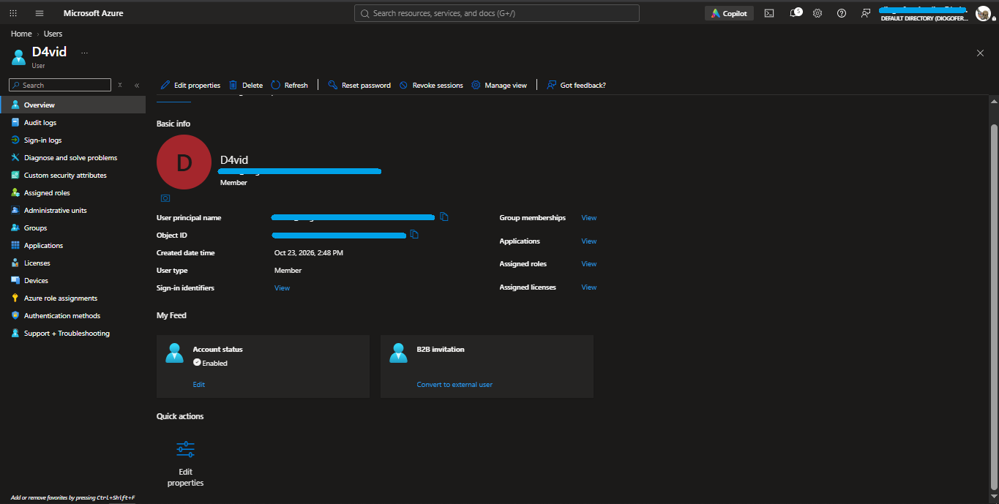
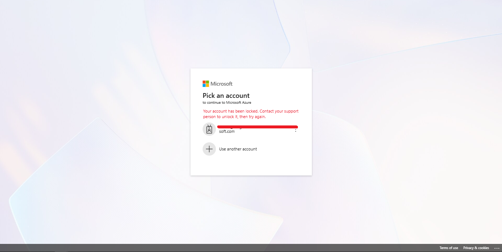
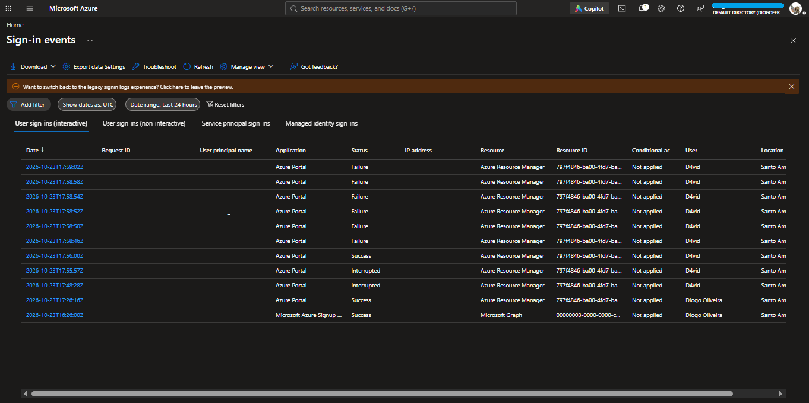
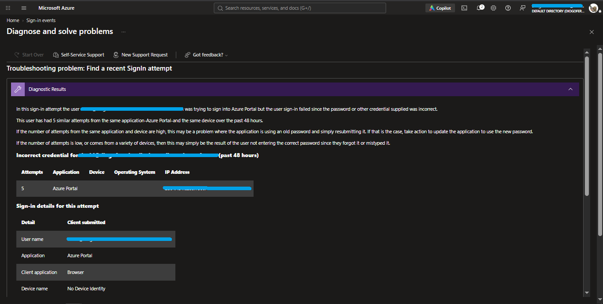
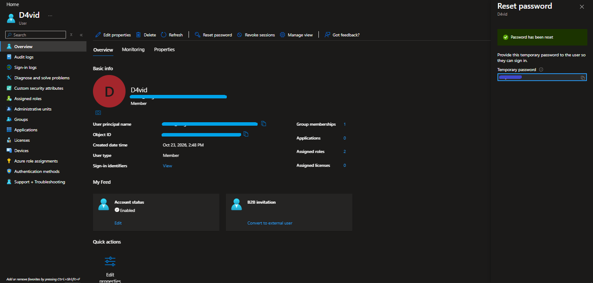

# Tier 1 IT Support Lab with Microsoft Entra ID (Azure AD)

A personal lab built to practice everyday **Tier 1 Support / Service Desk** tasks in my own environment: account creation and management, access control, password resets, locked accounts, and troubleshooting failed sign-ins.

> All users in this lab are **fictional**. Personal data, IP addresses, and tenant identifiers have been hidden in the screenshots and the log file.

---

## Environment

| Item | Detail |
|---|---|
| Platform | Azure Portal (free account) |
| Service | Microsoft Entra ID (formerly Azure AD) |
| Users | Fictional profiles created by me |
| Browsers | Incognito window to simulate the end user's point of view |

> **Note:** Entra ID is the cloud identity service behind Microsoft 365. It is not on-premises Active Directory (Windows Server), but the core concepts of users, groups, and permissions are the same.

---

## What I practiced

1. [Creating and configuring users](#1-creating-and-configuring-users)
2. [Groups and roles](#2-groups-and-roles)
3. [Simulating failed sign-ins and account lockout](#3-simulating-failed-sign-ins-and-account-lockout)
4. [Troubleshooting with sign-in logs](#4-troubleshooting-with-sign-in-logs)
5. [Password reset](#5-password-reset)
6. [Full simulated ticket](#6-full-simulated-ticket)
7. [Lessons learned](#7-lessons-learned)

---

## 1. Creating and configuring users

I created fictional users in the tenant and filled in profile details such as **job title, department, location, and manager**, simulating the onboarding of a real employee.

- Each user gets a **UPN** (User Principal Name), which is the sign-in name in the format `name@domain.onmicrosoft.com`.
- On first sign-in, the user is required to change the temporary password.
- I also practiced **disabling** accounts, as would be done when an employee leaves the company.

---

## 2. Groups and roles

I organized users into **groups** and assigned administrative **roles**.

- **Group:** a collection of users, used to grant access in bulk (to an app, a folder, or a license) instead of configuring each user individually.
- **Role:** a set of administrative permissions within Entra ID (for example, who can reset passwords or create users).

| User | Group(s) | Role(s) |
|---|---|---|
| Trevor | Data Analyst | Insights Analyst, Desktop Analytics Administrator |
| D4vid | Help Desk | HelpDesk Administrator, User Administrator |

---

## 3. Simulating failed sign-ins and account lockout

To simulate an "I can't log in" ticket, I deliberately entered the wrong password for one of the fictional users several times in a row, using an incognito window.

Result: Entra ID **locked the account** and showed the user this message:

> *"Your account has been locked. Contact your support person to unlock it, then try again."*

**User's view:** the message tells them to contact support. This is how the ticket typically reaches Tier 1.

---

## 4. Troubleshooting with sign-in logs

On the admin side, I opened **Sign-in events** to understand what happened.

What I observed in the log:

- The fictional user's events show **Status: Success, Interrupted, and Failure**. The *Interrupted* events correspond to the first sign-in, where the system requires user action (password change).
- After that, there are **several failures within a few seconds**, matching the attempts with a wrong password.
- Application accessed: **Azure Portal**. Conditional Access: **Not applied**.

I also used the **Diagnose and solve problems → Find a recent SignIn attempt** tool, which explains the failure in plain language:

Diagnostic conclusion: the sign-in failed because **the password provided was incorrect**. The tool notes that when there are many attempts from the same application and device, an app may be resubmitting an old password, and when attempts are few or come from different devices, the user most likely forgot or mistyped the password.

### Exported log

I exported the events as CSV: [`logs/InteractiveSignIns.csv`](logs/InteractiveSignIns.csv).

Columns I used in the analysis:

| Column | What it shows |
|---|---|
| Date (UTC) | Date and time of the ocurrency |
| User agent | Which browser that person was using to connect |
| User | Person's User who is trying to login|
| Username | Person's Username who is trying to login |
| User type | The type of user who is trying to login, either a member or a guest |
| Application| Through which platform that person is trying to access |
| Status| The status of the login tries, being a failure, interupted or success |
|Sign-in error code | The sign-in error code tells us what was the error |
|Failure reason | the reason for the error |
|Client app	| Which platform that person was using to login |
|Browser | Which browser that person was using |
|Operating System | Which system that person was using |

| Error code | Meaning |
|---|---|
| 50126 | Error validating credentials due to invalid username or password. |
| 50055 | The password is expired. |
| 50140 | This occurred due to 'Keep me signed in' interrupt when the user was signing in. |

---

## 5. Password reset

As an administrator, I reset the user's password from the portal (**Users → Reset password**). The system generates a **temporary password**, which must be passed to the user through a secure channel. On first sign-in, the user is forced to change it.

Points I followed:
- Verify the user's identity before resetting;
- Never record the temporary password in the ticket;
- Instruct the user to change the password on first sign-in.

---

## 6. Full simulated ticket

| Field | Entry |
|---|---|
| **Title** | User cannot sign in to Azure Portal |
| **User report** | "It says my account has been locked." |
| **Classification** | Incident, access/sign-in |
| **Priority** | Medium (user cannot access the system) |
| **Initial diagnosis** | Sign-in logs show several consecutive failures due to an incorrect password, followed by the account being locked. The account is enabled (*Account status: Enabled*). |
| **Probable cause** | Repeated attempts with a wrong password |
| **Action taken** | [describe: password reset / unlock / waiting for the lockout period, according to what you did] |
| **Result** | [user was able to sign in normally] |
| **Escalation to Tier 2** | Not needed |

---

## 7. Lessons learned

- **Groups and roles are different things.** Groups organize who has access to what. Roles define what an administrator can do.
- **The UPN is a sign-in name, not a mailbox.** A mailbox only exists if the user has a Microsoft 365 license that includes email.
- **Sign-in logs are the first source of diagnosis** for sign-in problems: they show who tried, when, from where, in which application, and why it failed.
- **The portal's guided diagnostic** helps tell a typing mistake apart from an application using an old password.
- **What the user sees and what the administrator sees are two views of the same problem.** Understanding both makes it easier to explain the solution clearly.
- **Security in support work:** verify identity before touching accounts, and never expose passwords in tickets or screenshots.
- **Documentation is part of the job.** Recording the steps and ticket history helps Tier 2 and feeds the knowledge base.

**Author:** 
Diogo Oliveira
